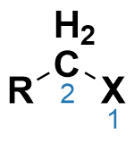

# Library Details

## Molecule Identification
The initial library of primary alkyl bromides was selected from the Auto-QChem database developed by the Doyle Lab. After excluding benzylic, allylic, and propargylic bromides, a curated set of 887 structurally diverse and synthetically tractable primary alkyl bromides was obtained. This final collection represents a broad range of substitution patterns and functional group compatibility, ideal for cross-coupling reactivity studies.

## Conformational Searching & Conformer Selection

To account for the conformational flexibility of the substrates at a reasonable computational cost, each unactivated primary alkyl bromide underwent a gas-phase conformational search using Schrödinger MacroModel with the OPLS4 force field. All conformers within 21 kJ/mol (5.02 kcal/mol) of the global minimum were retained, excluding mirror-image duplicates.

If the ensemble contained more than 20 conformers, the set was reduced using atomic root mean square deviation (RMSD) clustering. The optimal number of clusters was determined by minimizing the Kelley penalty, and the centroids of these clusters were selected. The Kelley index helps identify the ideal number of clusters while ensuring that the selected conformers are structurally diverse.

## DFT Computations

All DFT geometry optimizations and sequent frequency calculations (Gaussian 16, rev C.01) were performed at the ωB97X-D/def2-SVP  level of theory. The corresponding geometries were used for a series of single-point energy calculations at the ωB97X-D/def2-TZVP  level of theory. 

From the DFT calculations, global, atomic, and bond-level properties were collected for each conformer using [Get Properties](https://github.com/SigmanGroup/Get_Properties). 

Atoms in the alkyl bromide functional group were consistently numbered as shown below, and the numbers are referenced in the descriptor names.

     

The dynamic range of properties across the conformational ensemble of a single alkyl bromide was summarized by using five condensed measures for each of the properties.

| Descriptor              | Definition                                                                                      |
| ----------------------- | ------------------------------------------------------------------------------------------------|
| Boltz                   | Boltzmann-weighted average of a property from all the conformers in an ensemble (T = 298.15 K)  |
| max                     | highest value of a property given by any conformer in an ensemble                               |
| min                     | lowest value of a property given by any conformer in an ensemble                                |
| low_E                   | value of a property from the lowest energy conformer in the ensemble                            |
| range                   | absolute value of the max - min property value within an ensemble                               |

An extended explanation of the computational workflow used to build the alkyl bromide library, as well as details on the collected and predicted descriptors can be found in the original publication supporting information.

## Citation
**Alkyl Bromides Sources:** Żurański, A. M.; Wang, J. Y.; Shields, B. J.; Doyle, A. G. Auto-QChem: An Automated Workflow for the Generation and Storage of DFT Calculations for Organic Molecules. React. Chem. Eng. 2022, 7 (6), 1276–1284. DOI: [10.1039/D2RE00030] (https://doi.org/10.1039/D2RE00030J)